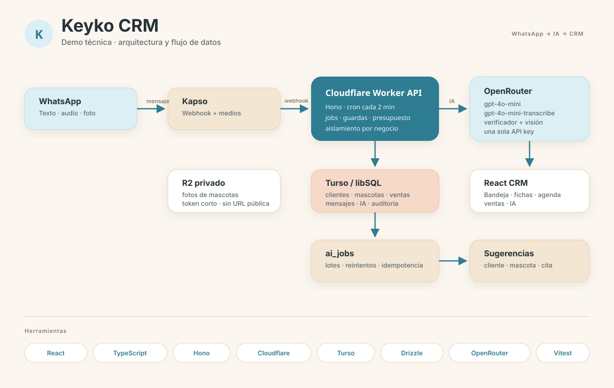
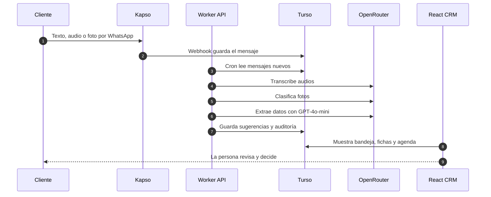

# Keyko CRM — demo

Demo funcional de un CRM para peluquería de mascotas: clientes, mascotas, agenda,
ventas, egresos, catálogo, bandeja de WhatsApp e IA para extraer información de
conversaciones y notas de voz.

Este repositorio es una **copia pública de demostración**. No contiene datos de
clientes, credenciales, URLs de producción ni configuración privada de
infraestructura.



## Flujo de un mensaje



## Herramientas


## Demo local

```bash
pnpm install
pnpm dev
```

- Web: `http://localhost:5173`
- API local: según la salida de `pnpm dev`
- Credenciales de la demo: `demo@keyko.local` / `Demo1234!`

La demo usa una base SQLite temporal con datos ficticios. No toca Turso,
Cloudflare, WhatsApp ni servicios reales.

## Qué incluye

- React + TypeScript + Vite.
- API con Hono para Cloudflare Workers.
- Esquema y migraciones SQL.
- Pruebas de API y frontend.
- Datos ficticios de demostración.
- Integración de IA preparada para configurarse con secretos propios.
- Procesamiento de texto, audios y fotos con revisión humana.

## Configuración

Copia `.env.example` a `.dev.vars` y llena tus propios valores locales.
No subas `.dev.vars` a Git.

Para desplegar en tu propia infraestructura, usa
`apps/api/wrangler.toml.example` como plantilla y configura tus secretos con
`wrangler secret put`.

## Licencia

Este repositorio se comparte como demostración técnica. No incluye datos reales
de Keyko ni de sus clientes.
